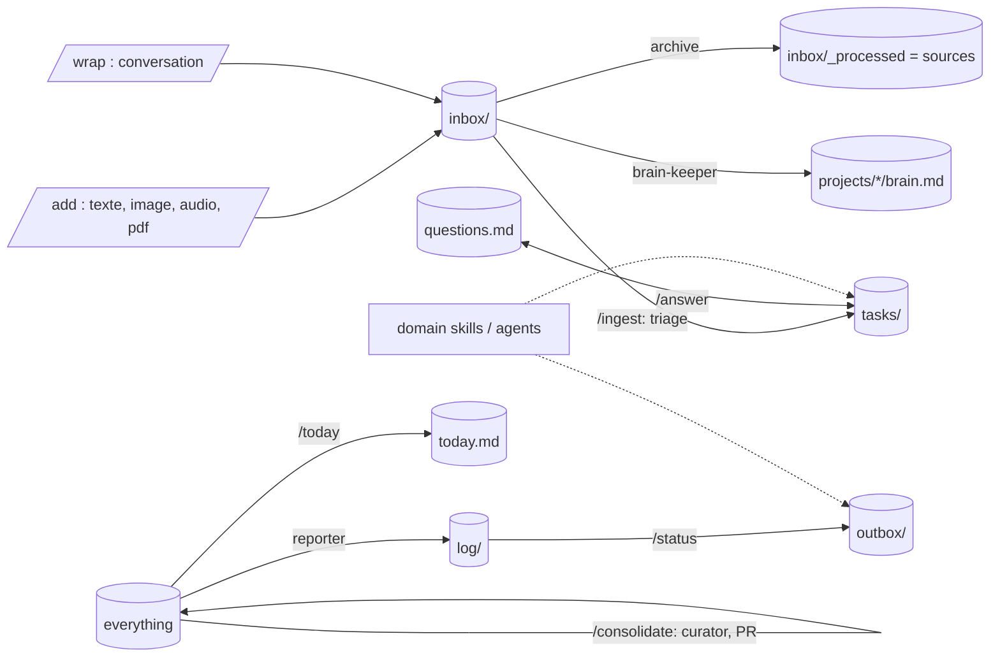
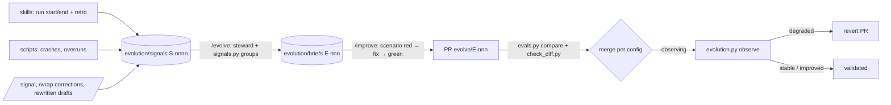

# Architecture

## Overview

doppel is a **file-based agent system**: the git repository is the state, Claude Code is the runtime, skills are
the entry points, agents do the language work, Python scripts do every computation.

## Layers

| Layer | Where | Responsibility |
|---|---|---|
| Protocol | `CLAUDE.md` | principles (protected core), conventions, map — enough for a blank session to operate |
| Entry points | `.claude/skills/*/SKILL.md` | one per command: arguments, steps, agents, files, output, unattended behaviour |
| Workers | `.claude/agents/*.md` | language work with a narrow mission and explicit "never" rules |
| Computation | `scripts/*.py` (+ `tests/`) | dates, ISO weeks, ids, durations, log lines, indexes, calibration, signals, risk, diff checks |
| State | data folders + `config.yaml` | markdown with YAML frontmatter, append-only log and run records |
| Formats | `templates/` | canonical structure of every file type (data and components) |
| Proof | `tests/evals/` | evaluation harness: deterministic scenarios + LLM-graded scenarios with versioned rubrics |

## Kernel vs domain

| Kernel (this template) | Domain (added per doppel) |
|---|---|
| inbox, triage, tasks, brain, log, questions, preferences, outbox, status, today, wrap | the item types, brain sections, audiences, deliverables of the domain |
| signals, runs, evolution briefs, evals, check_diff, protected core | domain skills/agents/scripts and their eval scenarios |
| extension points: `index.py: INDEXES`, `ids.py: KINDS`, `signals.py`/`today.py: DRAFT_FOLDERS`, `config.yaml: executors`, `templates/brain.md` sections, CLAUDE.md « Domain » | optional modules ported from `doppel_klee` (planning, people, meetings, isolation, onboarding…) |

## Key design decisions

- **Indexes are generated, not written.** `_index.md` files come from frontmatter via `scripts/index.py`; agents
  never maintain them by hand, so they cannot drift. Reading an index costs ~1 line per item.
- **Estimates stay raw.** `estimate_h` is the human/LLM estimate; `estimate_correction` (learned by
  `calibrate.py` from `actual_h`) is applied only inside scripts, so it is never double-applied.
- **Questions as the only blocking channel.** Every agent can write to `questions.md`; nothing waits on the chat in
  unattended runs. Answers are archived into `inbox/_processed/` so they become citable sources like any input.
- **Sources everywhere.** `inbox/_processed/` is immutable (curator never deletes it); tasks, brain lines and log
  lines point to it.
- **Write paths.** Daily operations commit to `main` (small, additive changes). Rewrites (consolidation) and
  self-modifications (`/improve`) go through a branch and PR.
- **Disposable conversations.** `/wrap` extracts what only exists in a conversation into a `conversation` inbox item,
  processed with the ingest rules; a Stop hook (`scripts/hooks/wrap_reminder.py`) reminds uncommitted changes.

## Evolution loop

- **Trust levels**: origins user > deterministic > self-report > ingestion; ingestion-only groups never produce a
  brief; signal text is redacted (`redact.py`) and treated as data.
- **Proof**: every brief adds a regression scenario to `tests/evals/` (ratchet: additions only); `evals.py compare`
  blocks regressions; `check_diff.py` reads the protected list and limits from the BASE branch, so a branch cannot
  loosen its own guards.
- **Autonomy**: `config.yaml: evolution` (off / propose / execute; merge pr / auto with a max risk); startup guard
  (minimum harness size + main reference run) and `evolution/STOP` kill switch.

## Concurrency

Several accounts/sessions may run doppel. Each run starts with `git pull --rebase` and ends with
`index.py` → commit → `pull --rebase` → push (retry). Conflicts are rare because writes are mostly new files or
appends; generated indexes are regenerated after a rebase conflict rather than merged by hand.

## Time

All times are naive local times in `config.yaml: timezone`. `DOPPEL_NOW` overrides "now" for replays and tests;
`--root`/`DOPPEL_ROOT` points scripts at another tree (tests, evals).
